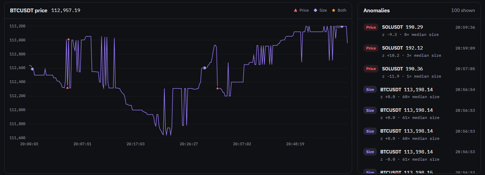

# Crypto Market Streaming & Anomaly Detection Platform

[](https://github.com/tanmayee043/crypto-streaming-platform/actions/workflows/ci.yml)
[](LICENSE)

A real-time pipeline that streams live crypto trades from Binance.US through Kafka, flags unusual price moves and unusually large trades per symbol, stores them in PostgreSQL, and reports which trades are missing using the exchange's trade IDs.

**Status:** runs locally with Docker Compose. It is [not deployed yet](docs/deployment.md), so there is no public demo.



## How it works

```
Binance.US WebSocket
        │
        ▼
producer.py ──► Kafka: crypto-trades
                        │
                        ▼
              anomaly_detector.py   scores each trade against that symbol's last 100 trades
                        │
                        ▼
                Kafka: trade-analytics
                        │
                        ▼
              storage_consumer.py   batched upserts into Postgres
                        │
                        ▼
                   PostgreSQL ──► FastAPI (main.py) ──► dashboard
                        ▲
                 gap_checker.py     missing trade IDs, completeness %
```

**Stack:** Python, Apache Kafka, PostgreSQL, FastAPI, Chart.js, Prometheus, Grafana, OpenTelemetry + Jaeger, Docker Compose, GitHub Actions.

## Guarantees

- **Exactly-once storage:** once a valid trade is in Kafka, it's stored exactly once, even if a consumer crashes. Offsets are committed only after the work is durable, and writes are idempotent.
- **Consistent scores:** the detector rebuilds its windows from Kafka on restart, so a reprocessed trade gets the same score.
- **Visible gaps:** missing trades are reported by trade ID, but not yet repaired.

These don't cover trades the producer never receives, such as during a network drop, or the loss of the single Kafka broker. [Details](docs/results.md#delivery-guarantee).

## Key results

Measured on a Windows laptop; none of these come from production. Methods and limits are in [docs/results.md](docs/results.md).

- **Crash tests:** 100 hard kills of each consumer, with 0 missing trades and 0 duplicates.
- **Anomaly model:** on 60,000 real trades, flags 2.9% of trades (down from 4.6%) and catches 95% of planted price spikes (up from 72%).
- **Latency:** p95 under 300 ms at a steady 1,000 trades/s.

## Limitations

- **Single point of failure:** one Kafka broker with no replication, on one machine.
- **Missed trades aren't repaired:** gaps are reported, but backfill isn't built yet.
- **No long-term figures:** nothing has run in production, so there's no 30-day completeness number yet.
- **Repeat flags:** one large order that fills in many parts can be flagged several times.

## Getting started

**Prerequisites:** Python 3.11+, Docker Desktop, Git. On Windows, use PowerShell or Command Prompt; Git Bash breaks the `docker exec` paths below.

**1. Install and start Kafka and Postgres**

```bash
git clone https://github.com/tanmayee043/crypto-streaming-platform.git
cd crypto-streaming-platform
python -m venv venv
venv\Scripts\activate              # Mac/Linux: source venv/bin/activate
pip install -r requirements.txt
copy .env.example .env             # Mac/Linux: cp; then set your own password
docker compose up -d --wait
```

**2. Create the Kafka topics (once)**

```bash
docker exec kafka /opt/kafka/bin/kafka-topics.sh --bootstrap-server localhost:9092 --create --topic crypto-trades --partitions 3
docker exec kafka /opt/kafka/bin/kafka-topics.sh --bootstrap-server localhost:9092 --create --topic trade-analytics --partitions 3
docker exec kafka /opt/kafka/bin/kafka-topics.sh --bootstrap-server localhost:9092 --create --topic crypto-trades-dlq --partitions 3
docker exec kafka /opt/kafka/bin/kafka-topics.sh --bootstrap-server localhost:9092 --create --topic trade-analytics-dlq --partitions 3
```

**3. Run each service in its own terminal**

```bash
python producer.py
python anomaly_detector.py
python storage_consumer.py
python gap_checker.py
python retention.py
uvicorn main:app --reload
```

**4. Open it**

- Dashboard: `http://localhost:8000/dashboard/` (the Replay button works without live trades)
- API docs: `http://localhost:8000/docs`
- Kafka UI: `http://localhost:8080`

On a brand-new stack, the first 2–3 minutes can be slow: trades may take over a minute to appear and the dashboard may show a latency breach. It settles by itself.

**When you're done:** `docker compose stop`

**Optional:** `docker compose --profile observability up -d` adds Prometheus (`:9090`), Grafana (`:3000`) and Jaeger (`:16686`). All settings are environment variables, listed in [`.env.example`](.env.example). If you have an older database, apply the files in `migrations/` in order.

## Testing

```bash
pip install -r requirements-dev.txt
ruff check .
ruff format --check .
mypy .
pytest                              # integration tests need Docker running
playwright install chromium         # once, for the browser test
pytest -m e2e                       # dashboard in a real browser; needs Docker running
```

CI runs these plus shorter crash tests on every push and pull request. [docs/results.md](docs/results.md) has the commands for the full crash, model and load tests.

## Project structure

```
producer.py, anomaly_detector.py, storage_consumer.py   the pipeline stages
gap_checker.py, retention.py     completeness checks; daily Postgres partitions
main.py, static/index.html       API and dashboard
service_setup.py                 settings checks, logging and shutdown shared by the services
alerts.py, rate_limit.py, kafka_helpers.py   Discord alerts, rate limits, shared Kafka helpers
schema.sql, migrations/          database schema and upgrades
observability/                   Prometheus and Grafana config
docker-compose.prod.yaml, deploy/   production stack and deploy scripts
replays/                         recorded trades for replay mode
scripts/                         recording, replay, crash and load tests
tests/                           unit and integration tests
docs/                            results, design decisions, deployment, runbook
```

## Documentation

- [Results and how they were measured](docs/results.md)
- [Design decisions, limitations and next steps](docs/design-decisions.md)
- [Architecture decision records](docs/adr/README.md)
- [Deployment plan and what's been tested](docs/deployment.md)
- [Runbook](docs/runbook.md)

## License

[MIT](LICENSE)
